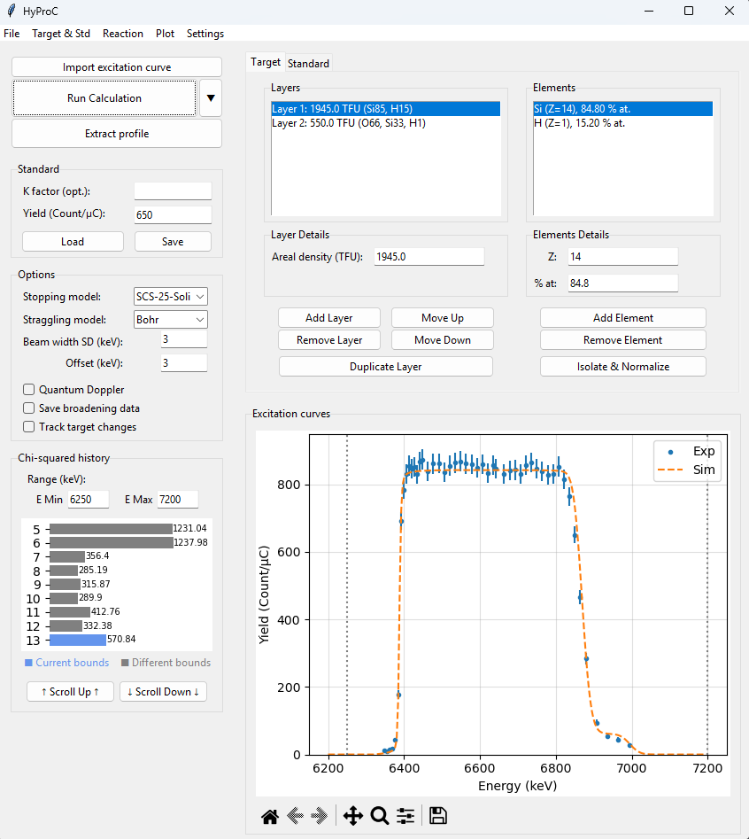

# HyProC

HyProC (Hydrogen Profiling by Convolution) is a Python application that simulates Resonant Nuclear Reaction Analysis (RNRA) excitation curves for hydrogen depth profiling (other elements can also be depth-profiled but it isn't the code's current speciality). Build a layered target, simulate its excitation curve, and compare it with experimental measurements using plots and chi-squared history.

This program was originally developed in the context of a [Master Thesis](https://researchportal.unamur.be/en/studentTheses/profilage-dhydrog%C3%A8ne-par-rnra/) at the [University of Namur](https://www.unamur.be/en) and is now one of the focus points of a [joint PhD](https://research.kuleuven.be/portal/en/project/3E260097) between the University of Namur and [KU Leuven](https://www.kuleuven.be/kuleuven).

For the calculation models and detailed controls, see the
[user manual](manual/HyProC_Manual.pdf).



## Installation

These instructions use Windows PowerShell. You need Python 3.10 or newer
with Tkinter. Git is only needed if you choose to clone the repository.

### Download HyProC

Download and extract the repository ZIP from GitHub, then open PowerShell
in the extracted folder containing `pyproject.toml`. If you have Git
installed, you can clone the repository instead:

```powershell
git clone https://github.com/LouisDupont-2/HyProC.git
cd HyProC
```

### Choose an installation method

From PowerShell in the HyProC folder, follow **one** of the two methods
below. Some of HyProC's Python libraries have minimum version requirements
(see [pyproject.toml](pyproject.toml) for details). A virtual environment
keeps HyProC's dependencies separate from those of your other projects.

#### Install in a virtual environment (recommended)

Create a virtual environment named `.venv`, then install HyProC and its
dependencies into it:

```powershell
python -m venv .venv
.\.venv\Scripts\python.exe -m pip install .
```

This command uses the virtual environment's Python directly, so you do not
need to activate it for installation. If you prefer to activate the virtual environment, run the following commands in PowerShell from the HyProC folder. After activation, `python` uses the virtual environment in that PowerShell window: 

```powershell
.\.venv\Scripts\Activate.ps1
python run_hyproc.py
```

#### Install without a virtual environment

To install HyProC and its dependencies into your current Python environment,
run:

```powershell
python -m pip install .
```


## Launch HyProC

Open PowerShell in the HyProC folder. If you installed HyProC without a virtual environment, or already activated it in this PowerShell window, run:

```powershell
python run_hyproc.py
```

If you installed HyProC in `.venv` and prefer to run it without activation, use:

```powershell
.\.venv\Scripts\python.exe run_hyproc.py
```

## Try an example

In the desktop app, choose **File → Load simulation**, open one of the JSON simulation files located in the `examples/` folder, and click **Run Calculation**. The example uses SCS-25-Solid for stopping cross-sections and thus runs without SRIM.

From the HyProC folder, use `hyproc` if you installed it in your current Python environment or activated .venv in this PowerShell window.

```powershell
hyproc simulate "examples/15N on 1H - a-SiH16 SiO2 Si(sub) sample.json" --output rerun.json
```

If you installed HyProC in `.venv` and haven’t activated it, replace ``hyproc`` with ``.\.venv\Scripts\hyproc.exe``.

## Basic workflow

1. Open **Reaction** and define the projectile/target atomic number and mass number, as well as the resonance parameters of your measurement (energy, width and peak cross-section).
2. Create or load the layered target.
3. Create or load a standard and enter its measured yield, or enter a manual
   K factor.
4. Choose the stopping model and calculation options.
5. Load an experimental excitation curve, or define a custom energy range.
6. Run the calculation and compare the curves. Adjust the target and options
   as needed, using the chi-squared history to track the comparisons.
7. Save the simulation to resume it later, or export the simulated curve.

See the [manual](manual/HyProC_Manual.pdf) for input formats, units, model
details, and the full workflow.

## Integration with scripts and other tools

The Python API and terminal command let other scripts and analysis workflows
call HyProC's simulation engine. Both use the same calculation code as the
desktop application.

### Run a saved simulation from Python

```python
from hyproc.simulation import simulate
from hyproc.simulation_io import load_simulation

simulation = load_simulation("simulation.json")
result = simulate(simulation)
print(result.energy, result.yield_values)
```

The calculation uses the energies of the saved simulated curve, then the
embedded experimental curve, then the saved energy range if neither curve has
energies. The energy offset is applied as in the desktop app. The SCS-25-Solid
model runs without Tkinter or writable settings. For a simulation saved with
SRIM, pass `srim_path` with the installation directory. SRIM uses its own
input and output files in that directory.

### Run a saved simulation from the terminal

```powershell
hyproc simulate "simulation.json" --output rerun.json
```

The command uses the same energy selection as the Python example. It writes
a complete simulation JSON that you can open in the desktop app or use in
another run. For a file that uses SRIM, include `--srim-path` with the installation
directory. Run `hyproc simulate --help` to see the options.

## First-run settings

The top-level `run_hyproc.py` uses the `settings.json` beside the script.
The installed `hyproc` command uses the `settings.json` in the directory
you launch it from. If the file is missing, the desktop app creates it
from the bundled [defaults](src/hyproc/settings.example.json). Launch
either from the project root to use the same settings.

Open **Settings** and configure:

- **HyProC data save path:** an existing folder for calculation output.
- **SRIM Path:** the installation folder containing `SR Module`, if using the
  SRIM stopping model. This can remain blank when using SCS-25-Solid.
- **Column headers:** match the energy, yield, and yield uncertainty headers
  in your experimental data.

Your `settings.json` is ignored by Git. Edit the example file only when changing
the defaults distributed to new users.

## Repository layout

| Path | Purpose |
| --- | --- |
| `run_hyproc.py` | Recommended launcher for the desktop application |
| `src/hyproc` | Desktop application and calculation modules |
| `examples/` | Saved simulations you can open in the desktop app or run from the terminal |
| `data/` | Stopping-model parameters |
| `manual/` | User manual, LaTeX sources, and [rebuild instructions](manual/README.md) |
| `tools/` | Supporting scripts |

## Documentation and license

- [User manual](manual/HyProC_Manual.pdf)
- [Changelog](CHANGELOG.md)
- [GNU General Public License, version 3](LICENSE)

## Contact

louis.dupont-2@unamur.be ([LinkedIn](https://www.linkedin.com/in/louis-dupont-33355a2a4/))
