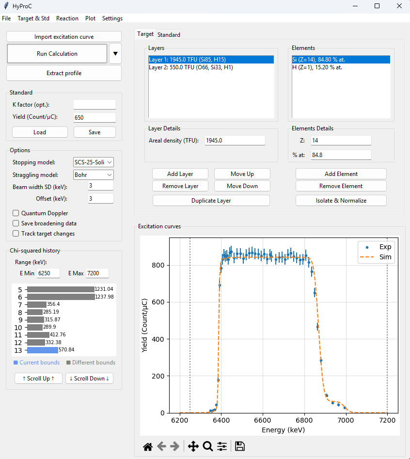

# HyProC

HyProC (Hydrogen Profiling by Convultion) is a Python code that simulates Resonant Nuclear Reaction Analysis (RNRA) excitation curves to do hydrogen depth profiling (other elements can also be depth-profiled but it isn't the code's current speciality). Build a layered target, simulate its excitation curve, and compare it with experimental measurements using plots and chi-squared history.

This program was first developped in the context of a [Master Thesis](https://researchportal.unamur.be/en/studentTheses/profilage-dhydrog%C3%A8ne-par-rnra/) at the [University of Namur](https://www.unamur.be/en) and is now one of the focus point of a [joint PhD](https://research.kuleuven.be/portal/en/project/3E260097) between the University of Namur and [KU Leuven](https://www.kuleuven.be/kuleuven).

For the calculation models and detailed controls, see the
[user manual](manual/HyProC_Manual.pdf).



## Installation

The instructions below use Windows PowerShell. SRIM integration requires an
external Windows SRIM installation; SRIM is not included in this repository.

You need Python 3.10 or newer with Tkinter, and Git if cloning from a terminal.
Alternatively, download and extract the repository ZIP from GitHub and open
PowerShell in the extracted folder.

```powershell
git clone https://github.com/LouisDupont-2/HyProC.git
cd HyProC
python -m venv .venv
```

Install the application dependencies in the virtual environment:

```powershell
.\.venv\Scripts\python.exe -m pip install numpy scipy pandas matplotlib periodictable xlwings openpyxl xlrd
```

Launch the application:

```powershell
.\.venv\Scripts\python.exe UI.py
```

These commands use the environment's Python directly, so activating the
environment is optional. The dependency list comes from the current source;
the repository does not yet provide a pinned dependency file.

## Basic workflow

1. Open **Reaction** and define the projectile/target atomic number and mass number, as well as the resonance parameters of your measurement (energy, width and peak cross-section).
2. Create or load the layered target.
3. Create or load a standard and enter its measured yield, or enter a manual
   K factor.
4. Choose the stopping model and calculation options.
5. Load an experimental excitation curve, or define a custom energy range.
6. Run the calculation and compare the curves. Adjust the target and options
   as needed, using the chi-squared history to track the comparisons.
7. Save the simulation to resume it later, or export the simulated curve.

See the [manual](manual/HyProC_Manual.pdf) for input formats, units, model
details, and the full workflow.

## First-run settings

HyProC automatically creates `settings.json` from
[`settings.example.json`](settings.example.json) when the local file is missing.
Existing settings are preserved. The template starts with blank paths.

Open **Settings** and configure:

- **HyProC data save path:** an existing folder for calculation output.
- **SRIM Path:** the installation folder containing `SR Module`, if using the
  SRIM stopping model. This can remain blank when using SCS-25-Solid.
- **Column headers:** match the energy, yield, and yield uncertainty headers
  in your experimental data.

Your `settings.json` is ignored by Git. Edit the example file only when changing
the defaults distributed to new users.

## Repository layout

| Path | Purpose |
| --- | --- |
| `UI.py`, `UI_geometry.py` | Application entry point and interface layout |
| `dialog_*.py` | Settings, reaction, import, and energy-range dialogs |
| `class_models.py` | Target, layer, and element models |
| `calc_stopping.py` | Stopping cross-section calculations |
| `calc_broadening.py`, `calc_curve.py` | Broadening and excitation-curve calculations |
| `data/` | Bundled stopping-model parameters |
| `settings_config.py`, `settings.example.json` | Local settings initialization and shared defaults |
| `manual/` | PDF manual, LaTeX sources, and [rebuild instructions](manual/README.md) |
| `tools/` | Supporting scripts |

## Documentation and license

- [User manual](manual/HyProC_Manual.pdf)
- [Changelog](CHANGELOG.md)
- [GNU General Public License, version 3](LICENSE)

## Contact

louis.dupont-2@unamur.be ([LinkedIn](https://www.linkedin.com/in/louis-dupont-33355a2a4/))